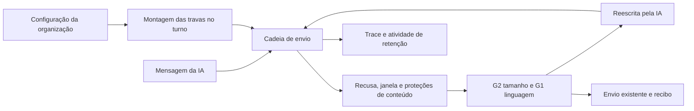

# G1 e G2: linguagem e tamanho das mensagens

Estado em 23/10/2026: candidata local, desligada por padrão. Sem publicação,
alteração de configuração, banco, agente comercial, IA paga ou mensagem real.
A revisão independente e a integração são responsabilidade da sessão principal.

## Contrato aprovado

- G1 detecta somente `gostaria`, `veja`, `trabalhar a constância`, `cujo`,
  `mediante`, `ademais`, `o qual` e `selecione`, com fronteiras de palavras,
  maiúsculas/minúsculas e normalização Unicode. Não amplia para flexões ou
  sinônimos. URLs não entram na busca; o texto ao redor continua avaliado.
- Origem: CRM-089 e CRM-108 no `docs/decisoes/REGISTRO.md` do repositório de
  controle `crm-agentico`; lista em `lab/agente/textos/v0.65.md`, §8, e histórico
  v0.31 de `docs/comercial/02-instrucao-comercial-do-agente.md`.
- G2 mede cada bolha física gerada pelo divisor existente, excluindo somente
  trechos reconhecidos como URL por `link-permitido.ts`. Espaços, rótulos de
  Markdown, e-mails e pontuação externa contam. A contagem usa pontos de código,
  como o comportamento vigente; não promete contar grafemas compostos.
- O limite padrão continua **700**, configurável pelo `max_caracteres` existente.
  Não aplica 250, não encurta o literal de matrícula e não altera a decisão P4.
- Duas bolhas de 500 caracteres passam pelo novo modo, se couberem no teto do
  turno. O modo antigo continua contando o total da resposta e os links.
- A integridade dos links e o teto de mensagens são mantidos. Não se corta nem
  reescreve texto automaticamente. A autorização de uma URL continua sendo
  responsabilidade das travas de conteúdo anteriores.

## Configuração, sem ativação implícita

As opções moram em `organizations.settings.travas_de_envio`, lidas uma vez por
organização e turno pelo mecanismo existente. Exemplo de contrato, **não aplicado**:

```json
{
  "linguagem_formal": { "ligada": true },
  "texto_longo": {
    "ligada": true,
    "max_caracteres": 700,
    "por_bolha_sem_urls": true
  }
}
```

Sem `linguagem_formal.ligada`, G1 não julga. Sem `por_bolha_sem_urls`, todas as
regras anteriores de `texto_longo` permanecem. G2 também exige `texto_longo.ligada`.
Nenhuma mudança de schema ou credencial é necessária.

A tela Segurança descreve as duas capacidades na lista existente, sem fingir
que foram ativadas ou criar um botão sem gravação. O avaliador textual isolado
declara que não as executa, pois não lê a configuração da organização.

**Limite operacional:** não há botão/rota específica para estas opções. O roteiro
`lab/producao/travas_producao.py` do controle era o caminho autorizado para as
travas anteriores, mas seu conjunto substituía `texto_longo` inteiro. Antes de
qualquer ativação, a integração deve usar a correção de preservação das opções
ou um contrato explícito de aplicação/releitura/volta. Não aplicar o roteiro
antigo supondo que preserve o novo modo.

## Encaixe no sistema



G1 entra depois de `texto_longo` e antes de `disclosure`; cadeia versão 16,
21 conferências. Trace registra código e quantidade de expressões, nunca o
trecho encontrado. G2 registra apenas contagens. O transporte não muda.

As duas são de estilo: primeiro veto pede reescrita; segundo desarma a respectiva
trava no turno e executa novamente a cadeia completa. Se o modelo não tentar de
novo, a saída útil existente reapresenta a mensagem retida à cadeia. Recusa,
atendimento humano, janela e bloqueios de conteúdo continuam valendo. Isso reduz
erros de estilo, mas **não promete eliminação absoluta** das palavras ou mensagens
longas. Não cria acompanhamento, caso, agendamento ou passagem à equipe por estilo.

## Achados da integração V1, corrigidos nesta entrega

1. Texto vetado por estilo → tentativa de vídeo inválida → encerramento do turno
   enviava o texto anterior. A limpeza da pendência agora acontece no início de
   `send_message`, antes da validação do vídeo.
2. Vídeo retido por estilo perdia `video_chave` na pendência e podia voltar como
   legenda avulsa. A chave agora acompanha a entrada retida até a nova tentativa.
   A preparação e o transporte de vídeo existentes continuam obrigatórios.

Essas falhas foram reproduzidas antes da correção. O controle com texto comum
mantém a segunda tentativa e a saída útil no fim. Um bloqueio surgido entre
tentativas continua impedindo o envio.

## Provas e limites

- `c01-linguagem-bolhas.test.ts`: 26 casos de lista, falsos positivos, Unicode,
  URLs, limite, modo antigo, organização e prioridade de recusa.
- `c01-estilo-video-pendente.test.ts`: 4 sequências, executando o preâmbulo,
  contador de estilo e fallback reais extraídos de `inbound-turn.ts`, com gates
  reais e transporte local espião. Não simula IA nem prova a conversa completa,
  banco, armazenamento de mídia ou entrega pelo canal.
- Regressão focada: forma da cadeia, lista da tela, avaliação textual, divisor,
  mensagem sem divisor, pergunta única, passagem desligada e vídeo nativo.
  São 141 casos em 10 arquivos aprovados nas execuções focadas; a última correção
  foi somente na cerca que pressupunha uma linha para a pendência, agora com vídeo.
- A sabotagem local desativando G1/G2 reprovou 14 dos 26 casos. Fontes restauradas
  byte a byte. A cerca de forma reprovou antes de atualizar versão/ordem; a da
  tela reprovou enquanto G1 não aparecia na lista.
- ESLint dos arquivos alterados: sem erro; dois avisos anteriores em
  `inbound-turn.ts` (importação sem uso e anotação de tipo).
- Typecheck geral: primeira tentativa esgotou heap; segunda interrompida pela
  coordenação para um portão integrado único. **Não aprovado nesta branch.**
- Publicação, releitura da configuração ativa, teste no celular e observação de
  envios reais continuam fora da evidência local. Nenhuma IA paga foi chamada.

Volta: desativar só as opções novas devolve a régua anterior, sem tocar outras
travas. Código exige a versão anterior do programa pelo processo de publicação
já aprovado. Dados de configuração devem ser guardados e relidos na operação.
